RISC-V Lab
==========

Run ``make html`` in the *docs/* directory to generate HTML documentation.

If you run the project outside of the MSC network follow *docs/tutorials/setup/index.rst* to install the required software.

RVlab: MIDI Wavetable-Synthesizer
=================================

**Authors:** Elias Rack, Armin Ebrahimi Saba, Emilie Ermer (TU Berlin)

The full project report is available in ``RVLAB_Finals.pdf``; the original task description is in
``RVLAB_Synthesizer_Specifications.pdf``.

1. Requirements specification
-----------------------------

The goal of the project is to implement a digital synthesizer on an FPGA, which is
controlled via a MIDI controller and outputs synthesized audio signals.

The synthesizer serves as a student teaching project within the RVlab, aiming to
teach digital technology, audio processing, and hardware/software co-design on FPGAs.

2. Functional specification
---------------------------

2.1 Core functionality
~~~~~~~~~~~~~~~~~~~~~~

**MIDI input**

- Receive MIDI input via serial input (DIN5 MIDI in)
- Support MIDI note on and note off events
- Typical behavior: press key → sound plays, release key → sound stops

**Sound synthesis**

- Sound synthesis implemented in digital logic
- Wavetable synthesis as method of sound synthesis
- ADSR envelope shaper

**Audio output**

- Audio output via line or headphone out of the FPGA board
- Mono output
- Sampling rate of 48 kHz
- 16-bit resolution

**System characteristics**

- End-to-end latency of 5 ms at most
- Modular architecture
- Testable modules (test modes if needed)

**System integration**

- Synth module running on FPGA (student module in the RVLab system)
- MIDI controller attached via DIN5 MIDI cable

2.2 Possible stretch goals (optional)
~~~~~~~~~~~~~~~~~~~~~~~~~~~~~~~~~~~~~

- Polyphony: at least 4 voices in parallel for playing chords
- Stereo sound
- Pitch-bend support
- Support MIDI channels
- Use MIDI CC to morph between waveforms
- Use MIDI CC to change ADSR values of the envelope shaper
- Use mod-wheel to manipulate sound character
- Support velocity: play different samples depending on key stroke strength
- Implement effects such as echo, reverb or flanger
- Explore alternative methods of synthesis

3. Diagrams
-----------

3.1 Hardware top level block diagram
~~~~~~~~~~~~~~~~~~~~~~~~~~~~~~~~~~~~

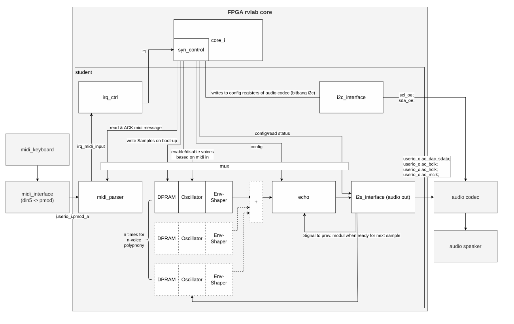

*Dotted lines represent components that are part of the polyphony stretch goal.*

3.2 Software top level block diagram
~~~~~~~~~~~~~~~~~~~~~~~~~~~~~~~~~~~~

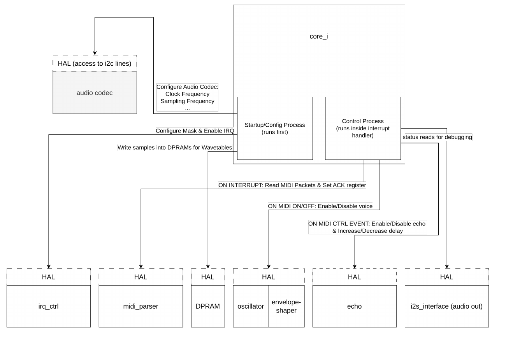

4. Module descriptions
----------------------

4.1 Verilog modules
~~~~~~~~~~~~~~~~~~~

MIDI Parser
^^^^^^^^^^^

*Functionality*

- Receive incoming MIDI packets
- Group packets together into a message and save it in a CPU-readable register
- Notify the CPU about an arrived note ON/OFF message using an interrupt
- Pull down the interrupt line as soon as the CPU has read the current message

*Interface description*

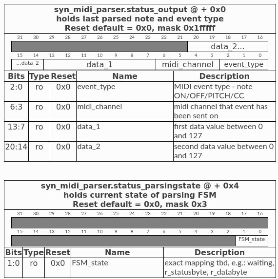

*Verification plan*

- Write a SystemVerilog module simulating the MIDI input
- Test at least the following input cases: note ON, note OFF, control events,
  unsupported MIDI event, invalid input (e.g. missing data bytes)

DPRAM Wavebank
^^^^^^^^^^^^^^

*Functionality*

- Hold samples for the oscillator module
- Hold at least two different samples so the oscillator can pick between them
- Writeable by software and readable by the oscillator module
- Variable sample length of at least 256 and at most 2048 samples
- Instantiation via template

*Memory map*

=================  ============  ==========================================
Address range      Size (bytes)  Description
=================  ============  ==========================================
0x0000 – 0x0FFF    4096          Wavetable 0 (up to 2048 samples × 16-bit)
0x1000 – 0x1FFF    4096          Wavetable 1 (up to 2048 samples × 16-bit)
...                ...           ...
=================  ============  ==========================================

*Verification plan*

- Verify that data written by the CPU can be read by the hardware correctly by
  checking equality of input and output
- Verify the outer ends of the address ranges

Oscillator + Envelope Shaper
^^^^^^^^^^^^^^^^^^^^^^^^^^^^

*Functionality*

- Oscillator module reading samples from the DPRAM
- One module represents one voice of a potentially polyphonic synth; a monophonic
  synth uses only one module
- Switched ON/OFF by the CPU via a writeable control register
- Implements an ADSR envelope shaper
- Envelope parameters controlled by the CPU through writeable registers
- Cycles through states based on note ON and OFF events
- For polyphony: signals availability of the voice through a status register when
  the release state finishes

*Interface description*

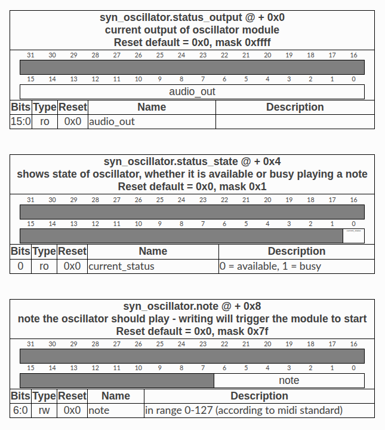

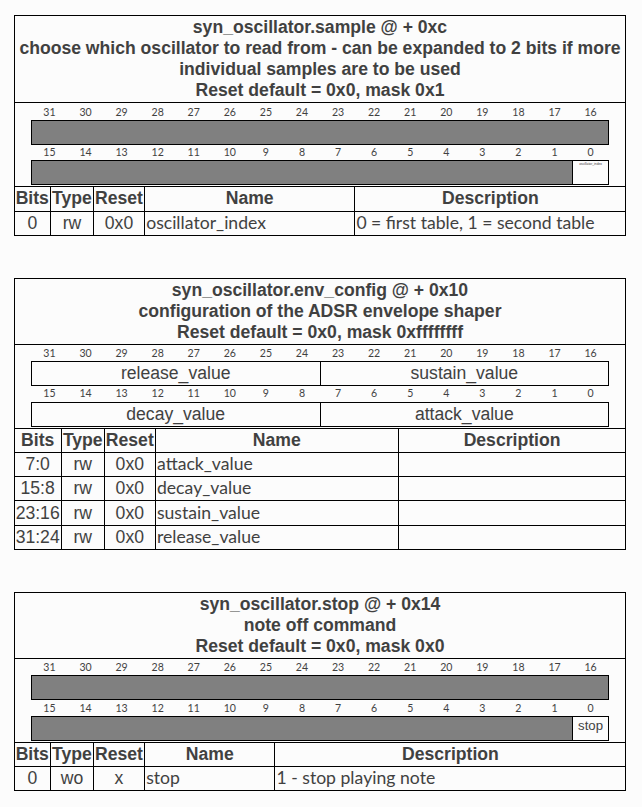

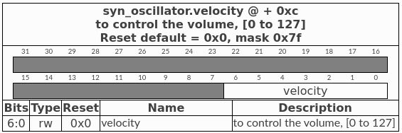

*Verification plan*

- Load a basic, easy-to-verify sample (sine wave) into the DPRAM
- Configure the envelope shaper in a default mode with constant ADS values and a
  release of 0
- Let the oscillator produce at least three different tones to verify that the
  frequency shift works correctly
- For every ADSR parameter, change the value while keeping the others constant and
  test with a fixed reference tone
- For every test write the output to a file so it can be analyzed numerically or
  played back
- Verify that the module reports readiness correctly (not too early or late) after
  being shut off, using at least two different release values

Mixer (part of the polyphony stretch goal)
^^^^^^^^^^^^^^^^^^^^^^^^^^^^^^^^^^^^^^^^^^

- Only relevant if polyphony is supported
- Summation and normalization of oscillator outputs
- Initially planned as a standalone module, but implemented as one sequential block
  in the student module
- Has no registers and testing is trivially easy

Echo Effect (stretch goal)
^^^^^^^^^^^^^^^^^^^^^^^^^^

*Functionality*

- Write samples into a ring buffer and mix them back into the output after
  ``delay`` samples
- Dynamically software-changeable parameters ``delay``, ``decay_gain`` and
  ``feedback_gain``
- Bypass option to dynamically enable/disable the echo effect in the pipeline

*Interface description*

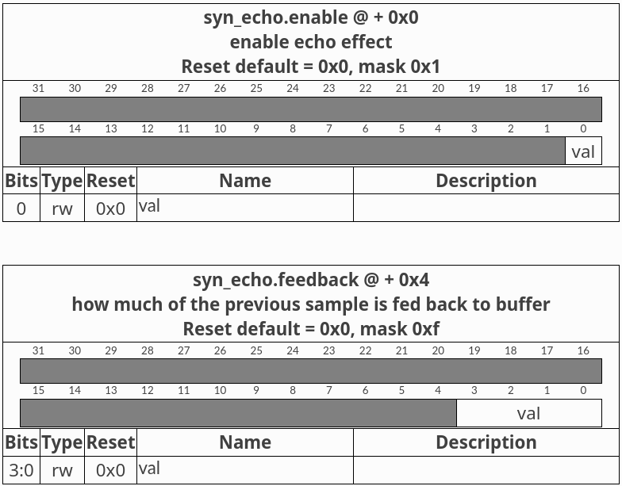

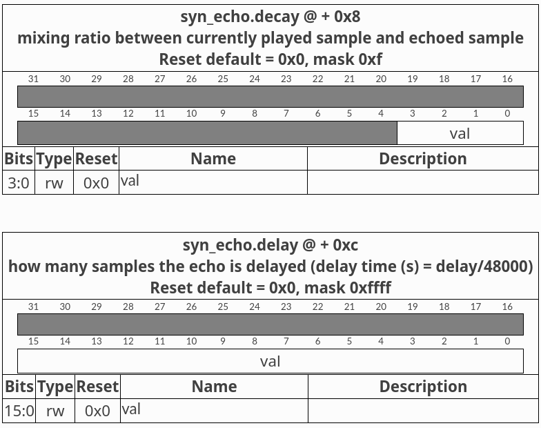

*Verification plan*

- Write a SystemVerilog testbench to generate samples
- Write the collected samples to a file for checking validity
- Verify dynamic change of parameters in the testbench

I2S Interface
^^^^^^^^^^^^^

*Functionality*

- Send samples to the codec via I2S
- Receive samples directly from the mixer or oscillator
- Feed back to the previous module when ready to receive the next sample

*Interface description*

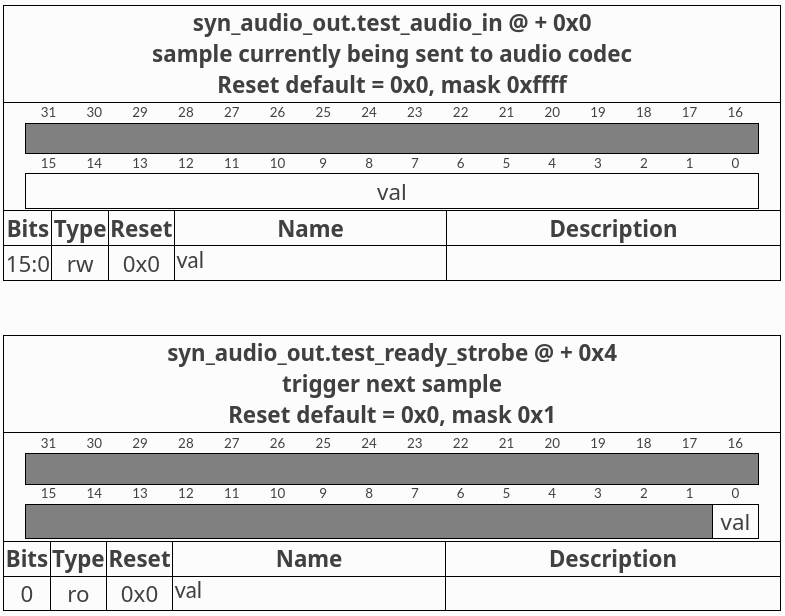

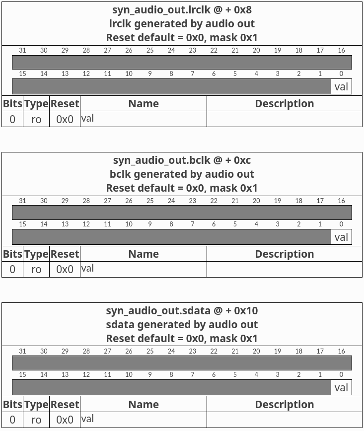

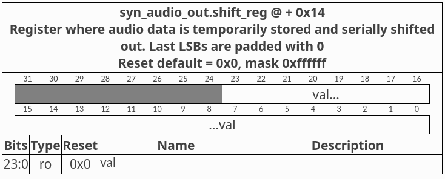

*Verification plan*

- Write a SystemVerilog module simulating the audio codec
- Write the collected samples to a file for checking validity
- Input a valid audio sample and cross-check against the output

I2C Interface
^^^^^^^^^^^^^

*Functionality*

- Provide access to the I2C interface of the audio codec to the CPU

*Verification plan*

- Software-based test using the module to configure a parameter of the audio codec
- Verify that software inputs using the HAL correctly manipulate SCL and SDA with
  regard to timing and values
- Model a bus slave (audio codec) for comprehensive testing

*Interface description*

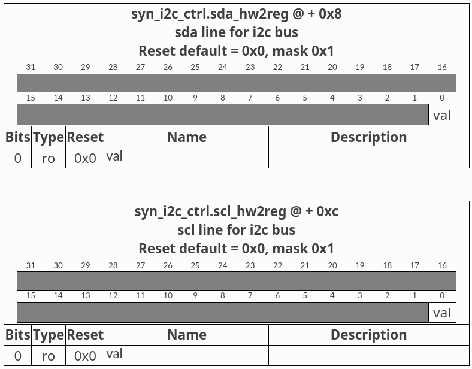

4.2 Software modules
~~~~~~~~~~~~~~~~~~~~

Configuration on startup
^^^^^^^^^^^^^^^^^^^^^^^^

- Write samples into the DPRAM for the oscillator
- Configure the audio codec for the correct sampling rate and bit width
- Enable interrupts and set the interrupt mask
- Possibly use or adapt https://github.com/bitbank2/BitBang_I2C

Application
^^^^^^^^^^^

- Interrupt based
- Enables a voice with the correct note on a MIDI ON event
- Disables the voice on a MIDI OFF event
- Handles overriding notes in a monophonic system (multiple simultaneous key presses)

The application software layer ended up using exclusively the HAL of the MIDI
parser, wavebank and oscillator to control the synthesizer. When adding polyphony,
a few simple for-loops were added to iterate over the multiple instances of the
sound-generating modules.

4.3 HW modules
~~~~~~~~~~~~~~

MIDI-PMOD Adapter
^^^^^^^^^^^^^^^^^

*Functionality*

- MIDI to PMOD
- Provides galvanic isolation using a 6N138 to prevent ground loops
- Supports optional bidirectional communication
- Operates using the I/O supply voltage provided by the PMOD connector

*Interface*

- Input: DIN-5 MIDI connector
- Output:

  - VCC (3.3 V)
  - GND (ground)
  - Pin 4: RX (3.3 V MIDI out), carries the MIDI signals entering the MIDI-IN 5-pin jack
  - Pin 3: not used
  - Pin 2: not used
  - Pin 1: TX (3.3 V MIDI in), signals routed to this pin are transmitted using the
    MIDI-OUT 5-pin jack

*Schematic and board*

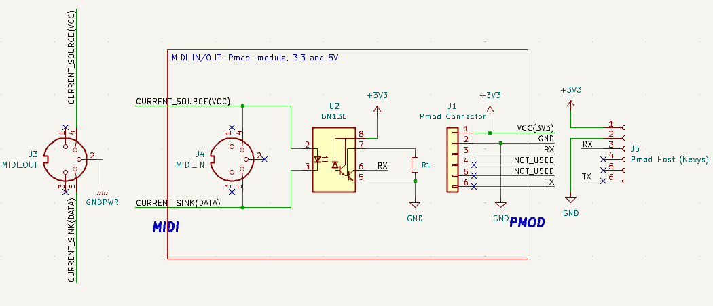

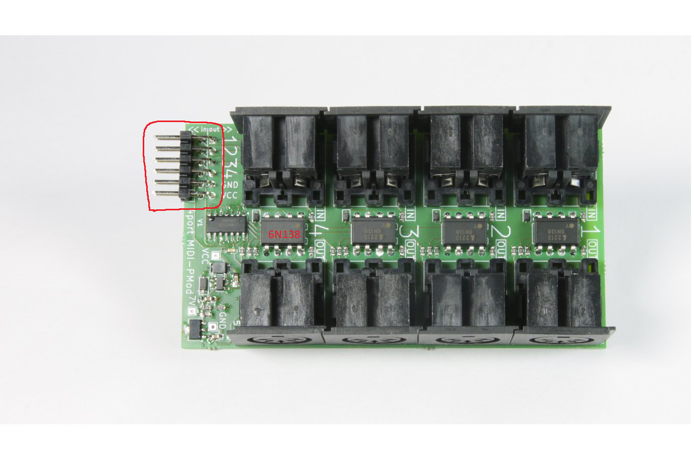

*PCB checklist*

- Power supply

  - case a: only use the IO supply provided on the PMOD / FMC connectors
  - case b: use of any external supply or DC/DC converter requires galvanic isolation
    of all signals (e.g. using ADUM), due to the power sequencing requirement of the
    FPGA and its sensitivity to any voltage other than the IO voltage

- Schematic review by the tutor
- Direction / pin mapping check before connecting to the FPGA

  - extension PCB: power up separately (not connected to the FPGA)

    - output pin check: measure the voltage at every output pin
    - input pin check: connect every input pin via a 10 kΩ resistor to VDD and VSS
      and measure the voltage (should be VDD and VSS, respectively)

  - FPGA

    - output pin check: measure the voltage at every output pin
    - input pin check: connect every input pin via a 10 kΩ resistor to VDD and VSS
      from the PMOD and measure the voltage (should be VDD and VSS, respectively)

5. Results
----------

Most core functionality and stretch goals are demonstrated in the video submitted
with the final presentation and are therefore only discussed briefly.

5.1 Core functionality
~~~~~~~~~~~~~~~~~~~~~~

MIDI input
^^^^^^^^^^

MIDI input was achieved by connecting a MIDI-PMOD adapter to the FPGA and
implementing the MIDI Parser Verilog module. A received MIDI packet is signaled to
the CPU via the interrupt line. Received messages are buffered only until the next
MIDI packet is fully parsed and then overwritten, which is sufficient as UART is
much slower than the CPU's operating frequency. During real-time operation with
multiple MIDI packets generated simultaneously by the controller, no MIDI message
was ever lost.

Sound synthesis
^^^^^^^^^^^^^^^

Sound synthesis uses a phase-offset pointer that is incremented by a constant,
precomputed offset. The size of the offset determines the note being played. The
oscillator reads the waveform from a DPRAM block, with resolutions from 256 up to
2048 samples supported for varying levels of audio quality. The DPRAM block has
enough capacity to store four different waveforms at the highest resolution. The
bit-width of the audio path is 16 bit.

Spectrum of a 392 Hz (G4) sine wave at 256-sample resolution, showing visible peaks
at other frequencies:

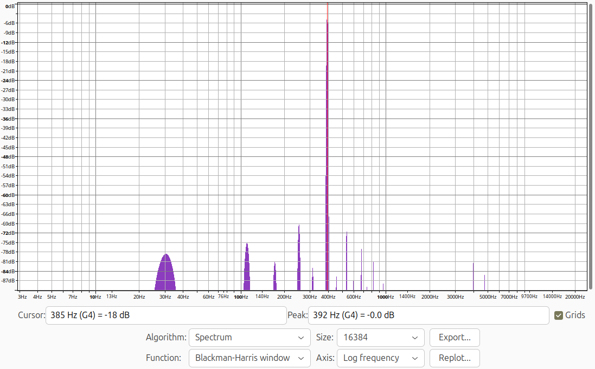

Spectrum of a 392 Hz (G4) sine wave at 2048-sample resolution, showing no peaks at
other frequencies except 392 Hz:

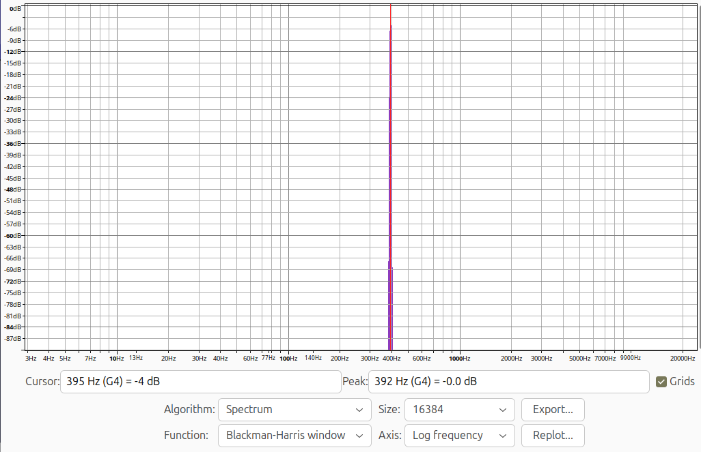

Audio output
^^^^^^^^^^^^

Audio output uses the ADAU1761 audio codec. The codec is configured to receive
samples at 48 kHz using I2S at a bit-width of 16 bit. It is configured over the I2C
bus by the CPU in software. The full configuration of the codec's internal audio path
can be found in the ``adau1761.c`` source file.

System characteristics
^^^^^^^^^^^^^^^^^^^^^^

Latency was estimated from simulation and not measured on the FPGA.

- IRQ line's positive edge until the oscillator starts playing: roughly 0.005 ms
- End to end, from reading the first MIDI bit until the first audio sample arrives at
  the I2S target: roughly 1 ms. Most of the time is spent parsing the MIDI bytes,
  since the UART receiver operates at a significantly slower frequency than the rest
  of the system.

5.2 Stretch goals
~~~~~~~~~~~~~~~~~

MIDI channels
^^^^^^^^^^^^^

The MIDI protocol supports up to 16 channels, intended for controlling multiple
instruments over one connection. The channel is carried in the status byte, the
first byte sent.

The synthesizer only reacts to messages on channels 1 to 4 and maps them to the four
waveforms stored in the wavebank. A note-on on channel 1 plays the note with the
first waveform in the wavebank, channel 2 plays the second waveform, and so on. This
lets the user play different waveforms simultaneously instead of having one global
waveform setting.

This was implemented by extending the CPU's interrupt handler, which tells the
oscillator module which waveform to play when activating it via TL-UL.

MIDI CC support
^^^^^^^^^^^^^^^

MIDI control change messages are used to change the configuration of the instrument.
Control numbers 74 to 77 configure the durations of the ADSR envelope shaper's four
phases, so the user can tweak the envelope in real time while playing. Because
control messages are tied to MIDI channels, all four MIDI channels can be configured
independently.

This was implemented by extending the CPU's interrupt handler, which writes the new
configuration values to the oscillator module via TL-UL.

Velocity
^^^^^^^^

MIDI note-on events carry a velocity value (0 to 127) in the second data byte,
representing the force with which the key was struck. Softer key presses (lower
values) are expected to sound quieter.

This was implemented with a velocity configuration register in the oscillator module,
which scales the output by the specified amount. The CPU writes to this register via
TL-UL in the interrupt handler when handling note-on events.

Echo effect
^^^^^^^^^^^

The echo effect constantly writes the current input sample into a ring buffer and
mixes it back into the output, delayed by a configurable number of samples. The
following parameters can be changed by software at runtime:

- **feedback gain:** how much of the delayed buffer output is fed back into the buffer
- **decay gain:** how much of the delayed buffer output is mixed into the current
  audio output
- **delay:** by how many samples each sample is delayed before being mixed back into
  the output

Audio sample without echo effect:

Echo effect (feedback=5, decay=15, delay=12000 samples):

Echo effect (feedback=15, decay=5, delay=12000 samples):

Echo effect (feedback=15, decay=15, delay=12000 samples):

Echo effect (feedback=15, decay=15, delay=20000 samples):

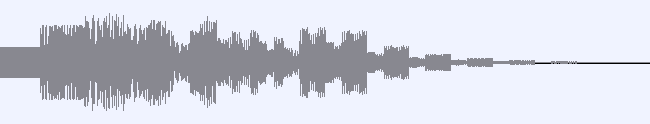

Polyphony
^^^^^^^^^

The core version of the synthesizer has a single oscillator module, so only one note
can be played at a time. Polyphony requires multiple oscillator modules whose outputs
are summed.

Our synthesizer duplicates the oscillator modules together with their wavebank DPRAM
blocks, so each oscillator has its own wavebank RAM. Both the Verilog and the software
make heavy use of parameterization, so versions of the system from 4 oscillators up
to 32 oscillators can be instantiated easily.

A key challenge is the growing bit-width when summing oscillator outputs. Bit-width
grows logarithmically with the number of operands, so for 32 oscillators a right
shift by 5 would be needed to keep a 16-bit output. Since the signals are independent
and rarely phase-aligned, constructive interference should not require such
compensation, and in normal operation all 32 voices are rarely active at once. We
therefore shift by only 3 and protect against overflow by saturating the output at
the maximum or minimum value when an overflow is detected. In practice a single
oscillator's output is only slightly quieter than before, and no harsh clipping noise
was observed while playing.

Excerpt from the waveform viewer showing all 32 oscillators playing notes of
increasing frequencies in parallel:

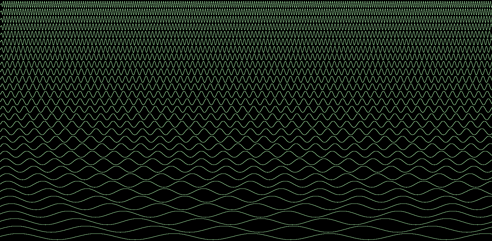

